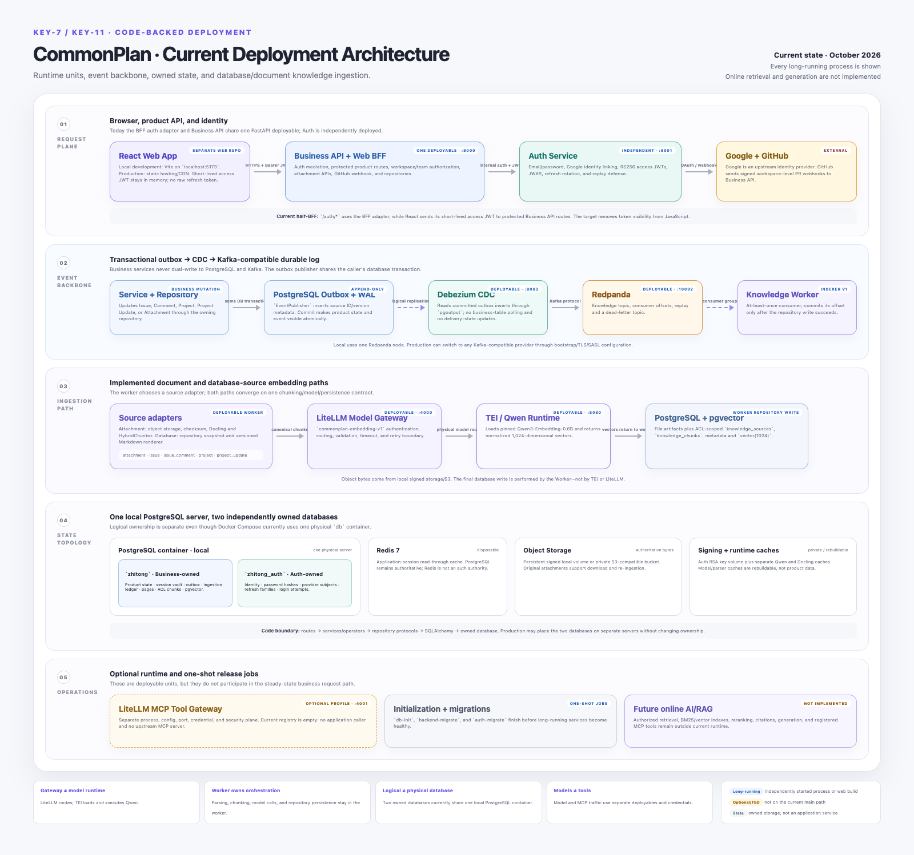

# CommonPlan current system architecture

This is the code-backed current-state architecture after the KEY-11 ingestion foundation. It is
intentionally different from the target design: CommonPlan now has local/S3-compatible attachment
storage, a transactional outbox captured from PostgreSQL WAL by Debezium, a Kafka-compatible
Redpanda event backbone, database and document knowledge ingestion, Docling parsing, a private
LiteLLM Gateway backed by Qwen/TEI, and canonical pgvector rows. It still has no online
retrieval/answer service, reranker, citation assembler, generation model, or registered MCP tool. An optional empty
LiteLLM MCP gateway profile now makes the future tool boundary independently deployable without
claiming any tool integration is complete.

## Deployable units

| Unit | Runtime responsibility |
| --- | --- |
| React Web App | Browser UI from the separate web repository. Local development uses Vite on `localhost:5173`; production serves the static build through hosting/CDN. Keeps the short-lived access token in memory and receives an opaque HttpOnly BFF session cookie. |
| Business API + Web BFF | One FastAPI deployable on port 8000. Owns `/auth/*` browser mediation, all protected product APIs, resource authorization, and the GitHub webhook. |
| Auth Service | Independent FastAPI deployable on port 8001. Owns credentials, Google identity linking, access-token signing, JWKS, refresh rotation, and login throttling. |
| Debezium CDC | Independent Kafka Connect process. Reads committed inserts from the append-only outbox through PostgreSQL `pgoutput`; it never queries product tables. |
| Redpanda | Kafka-compatible durable event broker. Owns topics, consumer-group offsets, replay and the dead-letter stream. Local development uses one node; production can use any Kafka-compatible managed provider. |
| Ingestion Worker | Separate Kafka consumer process. Loads authoritative attachments, Issues, Comments, Projects and Project Updates through repositories; renders/parses, chunks, embeds and persists idempotently. |
| LiteLLM Gateway | Private OpenAI-compatible service on port 4000. Authenticates the worker and maps `commonplan-embedding-v1` to the pinned physical embedding profile. |
| LiteLLM MCP Tool Gateway | Optional Compose profile on port 4001. Separate config and credential; currently an empty registry with no upstream MCP server or application consumer. |
| Qwen/TEI embedding runtime | Private local model service. Serves the pinned `Qwen/Qwen3-Embedding-0.6B` revision and returns normalized 1,024-dimensional vectors. |
| PostgreSQL server | One local `db` container hosts the independently owned `zhitong` and `zhitong_auth` databases. Production may place them on separate physical servers without changing ownership. |
| Initialization and migration jobs | One-shot `db-init`, `backend-migrate`, and `auth-migrate` jobs complete before the long-running services become healthy. |

## Storage ownership

| Store | Authority |
| --- | --- |
| Business PostgreSQL (`zhitong`) | Product entities, local profile projection, browser auth-session vault, application sessions, GitHub records, append-only outbox, file ingestion artifacts, knowledge sources/chunks, and canonical `vector(1024)` embeddings. |
| Redpanda log | Durable knowledge events, consumer offsets and DLQ records. It is transport/replay state, not the source of truth for product content. |
| Auth PostgreSQL (`zhitong_auth`) | Identity users, password hashes, external identities, refresh-token hash families, login codes, and login attempts. |
| Redis | Disposable read-through cache for application sessions. PostgreSQL remains the source of truth. |
| RSA key volume | Auth Service signing key material. The private key never crosses the identity boundary. |
| Attachment object storage | Signed persistent local volume in development or private S3-compatible storage in deployment. Original files remain the source for re-ingestion. |
| Model/Docling cache volumes | Persistent local caches for pinned Qwen weights and Docling assets; caches are rebuildable and are not authoritative product data. |

The two PostgreSQL rows above describe logical ownership, not two local database containers. Local
Compose uses one physical PostgreSQL server with two databases and independent Alembic histories.

## Trust and request flow

1. React sends login, refresh, logout, and Google-start requests to the BFF routes on port 8000.
2. The BFF calls Auth Service over its confidential internal channel. Raw refresh tokens exist only
   transiently in Auth Service and the BFF; Auth stores a hash and the BFF stores an encrypted copy.
3. React sends its short-lived access JWT directly to protected `/api/v1/*` routes.
4. The global router guard verifies RS256 signature, issuer, audience, client, token type, and time
   claims using Auth Service JWKS.
5. Resource policies then enforce workspace membership, Team membership/role, and resource ownership.
6. Services and optional operators call repository protocols. Only repository implementations access
   SQLAlchemy or PostgreSQL; architecture tests enforce this boundary.
7. Every indexable mutation writes product state and a `knowledge.source.*` outbox row in the same
   transaction. The service-facing `EventPublisher` persists only to that outbox; it never calls Kafka.
8. Debezium tails PostgreSQL WAL and routes committed outbox inserts to
   `commonplan.knowledge.v1` in Redpanda. The worker consumes with a durable consumer group.
9. Attachment events take the Docling path. Issue, Comment, Project and Project Update events use a
   deterministic Markdown renderer. Both paths chunk and embed through the same model alias. The
   worker commits the Kafka offset only after its repository transaction succeeds; exhausted events
   go to `commonplan.knowledge.dlq.v1`.

LiteLLM and TEI are deliberately separate deployables. LiteLLM authenticates and routes the stable
alias; TEI loads the pinned Qwen weights and performs inference. Vectors return to the worker, and the
worker's repository—not either model component—writes pgvector rows.

## External integrations

- Google is an upstream OAuth/OIDC identity provider. CommonPlan Auth Service remains the credential
  issuer used by Business API.
- GitHub sends signed pull-request webhooks to Business API. PR titles are matched against issue keys
  at workspace scope without project-to-repository mapping. `smee` is a local-development transport,
  not a production component.

## Implemented knowledge-ingestion boundary and remaining RAG seam

The offline ingestion foundation includes attachments and high-context database records, but it deliberately stops before search. There is no
vector/lexical search endpoint, query embedding path, ACL-filtered candidate retrieval, reranker,
citation assembler, or answer-generation model. LiteLLM is implemented locally for the embedding
path; production gateway PostgreSQL/virtual keys, budgets, and multi-replica governance remain a
deployment follow-up. Any future diagram must continue to distinguish implemented ingestion from
proposed online retrieval and generation.

The optional `tool-gateway` is scaffolding only. It proves that the MCP security plane can run as a
separate deployment, but it does not yet hold user OAuth tokens, expose application-approved tools,
or receive traffic from an Agent/AI service.

The editable visual source is
[`commonplan-current-architecture.html`](commonplan-current-architecture.html). Detailed auth and
request sequences remain in [`../system-architecture.md`](../system-architecture.md).

For the recommended deployment, independent BFF, and staged RAG direction, see the
[target full-system architecture](commonplan-target-architecture.md).
