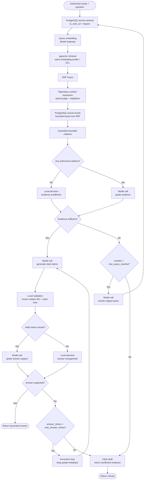

# Verify R4 Agentic RAG with Runpod

R4 keeps authentication and scope derivation before the graph, and keeps database access inside
repositories. Everything between the authorized scope and the final answer is coordinated by one
LangGraph state machine; retrieval is no longer an opaque service callback inside the answer graph.



With the current defaults (`max_query_rewrites = 1`, `max_answer_retries = 1`), the longest path
makes two retrieval attempts and at most seven model calls: two evidence grades, one query rewrite,
two answer generations, and two answer grades. Empty retrievals and structurally invalid drafts are
rejected locally without spending another model call.

The hybrid-search endpoint uses the same six retrieval nodes (`lexical_retrieve`, `embed_query`,
`vector_retrieve`, `fuse_rrf`, `expand_context`, and `rerank_results`) and stops after reranking. The
agentic answer endpoint continues through citation assembly and the bounded reasoning branches. Both
paths therefore share one retrieval implementation and expose `pipeline.orchestrator =
"langgraph-retrieval-v1"`.

The browser and Business API never receive a Runpod key. Business API calls the stable
`commonplan-generation-v1` alias with its LiteLLM credential; LiteLLM alone calls the account-owned
Runpod OpenAI-compatible endpoint.

Every structured grade/rewrite/generation prompt uses Qwen3's `/no_think` switch. These nodes need
bounded JSON, and allowing the model's default thinking mode can consume a small node token budget
while leaving the final OpenAI `content` field null. This does not remove the graph's explicit
evidence and answer-grading stages; it only prevents hidden chain-of-thought from replacing their
machine-readable result.

## 1. Create the scale-to-zero endpoint

Follow [`deploy/runpod/README.md`](../../deploy/runpod/README.md). Use the served model name
`commonplan-qwen`, active workers `0`, max workers `1`, a 30-second idle timeout, and FlashBoot.
Keep the endpoint ID and API key out of Git.

## 2. Configure local routing

Add the following to the ignored `.env`:

```dotenv
MODEL_GATEWAY_CONFIG_PATH=./deploy/litellm/config.runpod.yaml
RUNPOD_OPENAI_BASE_URL=https://api.runpod.ai/v2/<ENDPOINT_ID>/openai/v1
RUNPOD_API_KEY=<secret>
RAG_ANSWER_PROVIDER=model_gateway
RAG_ANSWER_STRATEGY=agentic
RAG_MAX_QUERY_REWRITES=1
RAG_MAX_ANSWER_RETRIES=1
RAG_GENERATION_TIMEOUT_SECONDS=390
```

Do not set `RUNPOD_API_KEY` in the Web repository or browser environment.

## 3. Verify the model boundary

```bash
python scripts/verify-runpod-generation.py
docker compose up -d --force-recreate model-gateway backend
docker compose logs --tail=100 model-gateway backend
```

The verifier prints status, model, latency, and token counts, but never prints the secret. The first
request may be cold; record cold and warm timings separately.

The timeout chain is deliberately ordered: LiteLLM waits up to 360 seconds for a scale-to-zero
provider request, Business API waits up to 390 seconds for LiteLLM, and Retrieval Lab waits up to
420 seconds for the complete bounded graph. This prevents a three-minute Runpod cold start from
finishing after an inner caller has already returned `503`. These longer budgets are a synchronous
R4 testing compromise; an asynchronous job/streaming UX remains production follow-up work.

## 4. Verify through CommonPlan

Use Retrieval Lab to submit a question with known indexed evidence. A successful R4 response has:

- `generation.grounding_status = "agent_validated"`;
- citations whose IDs are used by every returned claim;
- `agent.strategy = "full-retrieval-langgraph-v2"`;
- a bounded `agent.steps` list;
- aggregate prompt/completion token counts;
- `rewrites <= 1` and `answer_retries <= 1`.

For an unsupported question, expect `answer = null`, `status = "insufficient_evidence"`, and no
claims. The system must not present a plausible unsupported answer.

## 5. Automated checks

```bash
cd backend
pytest -q tests/test_agentic_retrieval.py tests/test_retrieval_answering.py tests/test_retrieval_service.py
pytest -q
```

These tests use a deterministic fake model. They verify orchestration and safety without incurring
Runpod cost; the endpoint smoke test remains an explicit deployment check.
