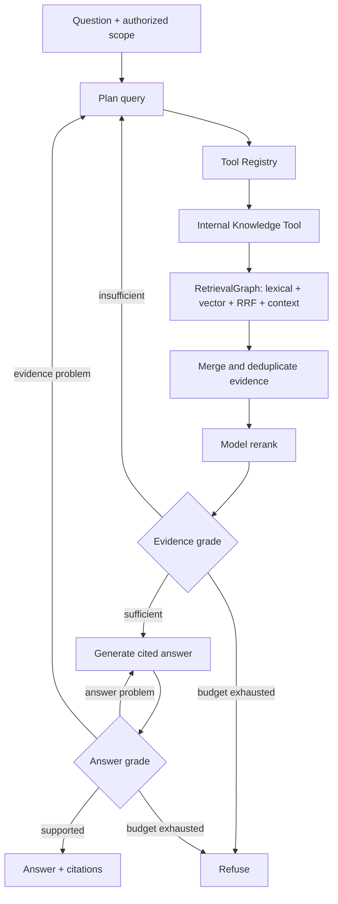

# Verify R5 Agentic AnswerGraph

R5 turns R4's bounded corrective RAG into a complete, small Agentic RAG proof of concept. The
Business API still derives the caller's workspace/team scope before the graph starts, and only the
retrieval repository executes SQL.



## Tool boundary

`ToolRegistry` is an explicit allow-list. R5 registers only `InternalKnowledgeTool`; it adapts the
existing RetrievalGraph to the common `ToolRequest -> ToolResult` contract. Adding web, MCP, or
product-API adapters later does not require changing AnswerGraph's merge, rerank, grade, generation,
or termination nodes. R5 intentionally does not ship those external adapters.

## Observable contract

Call `POST /api/v1/workspaces/{workspace_id}/retrieval/answer` with
`RAG_ANSWER_STRATEGY=agentic`. A successful response reports
`agent.strategy = agentic-answer-langgraph-v3`. Its `agent.steps` include `plan_query`,
`execute_tools`, the nested RetrievalGraph nodes, `merge_evidence`, `rerank_evidence`,
`grade_evidence`, `generate_answer`, and `grade_answer`.

The planner may produce at most three queries. Query replans and answer retries remain bounded by
`RAG_MAX_QUERY_REWRITES` and `RAG_MAX_ANSWER_RETRIES`. Unknown tool names are rejected. The answer
grader uses `supported`, `answer_problem`, or `evidence_problem`; the last outcome returns to the
planner rather than merely regenerating from inadequate evidence.

## Local tests

```bash
cd backend
PYTHONPATH=. python -m pytest -q
```

Focused tests prove multi-query decomposition/merge, evidence-driven replanning, bounded refusal,
invalid-citation rejection, and answer-only retry behavior.
